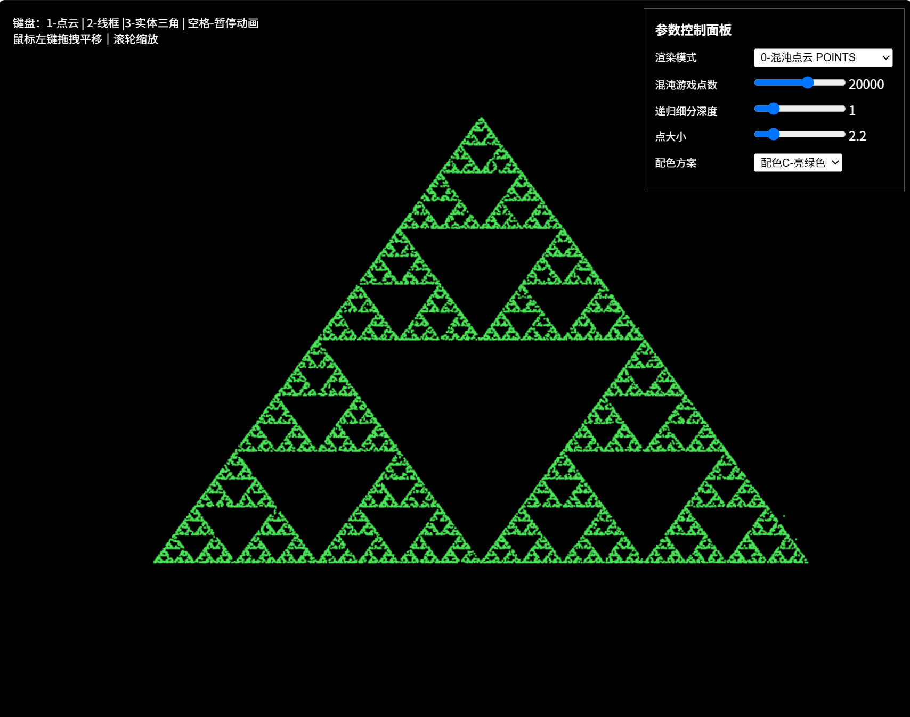
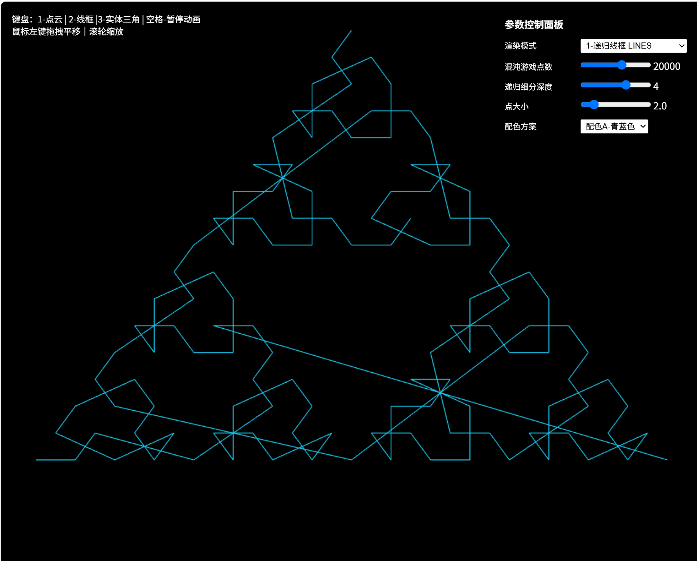
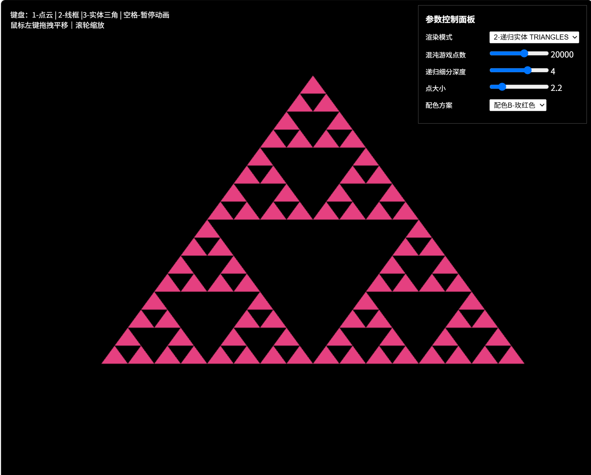

# AP1 交互式2D分形 — Sierpinski垫片
## 项目目标
理解WebGL顶点数据传输流程；实现**混沌游戏、递归细分**两种算法生成谢尔宾斯基垫片；完成鼠标、键盘、HTML参数面板全套交互。

## 算法原理
1. **混沌游戏（Chaos Game）**
给定三角形三个顶点，设置一个随机的初始点。循环中每次随机选取三角形其中一个顶点，把当前点更新为「当前点与选中顶点的中点」。迭代足够多次，点集合形成谢尔宾斯基垫片。使用`gl.POINTS`渲染，实现点数从0逐步增加的生长动画，空格可以暂停动画。

2. **递归细分 subdivide(a,b,c,depth,out)**
输入三角形三个顶点与递归深度depth。
- 如果`depth === 0`，直接把三个顶点写入输出数组；
- 如果depth>0，求出三角形三边中点，分割出3个小三角形，递归对三个子三角形继续细分；
递归结束后输出全部顶点，支持`gl.LINES`线框、`gl.TRIANGLES`实体填充两种模式。

## 运行方法
1. 将所有文件放在同一个文件夹；
2. 在文件夹启动静态http服务器，示例：
`python -m http.server 8000`
3. 浏览器访问 `http://127.0.0.1:8000`。

## 交互操作
### 键盘
- `1`：切换混沌游戏‑点云模式
- `2`：切换递归细分‑线框模式
- `3`：切换递归细分‑实体三角模式
- `空格`：点云模式下暂停/继续点生长动画

### 鼠标
- 左键按住拖拽：平移图形
- 鼠标滚轮：缩放图形

### HTML参数控制面板
- 渲染模式下拉：切换POINTS / LINES / TRIANGLES
- 混沌游戏点数滑条：调节点云总点数，范围5000‑30000
- 递归细分深度滑条：设置递归深度0‑6
- 点大小滑条：控制点元绘制尺寸
- 配色下拉：3套配色方案切换

## 程序截图
点云模式：

线框模式：

实体三角模式：

## 文件列表
- index.html：页面布局、画布、HTML参数UI面板
- main.js：着色器、分形算法、缓冲区操作、渲染循环、鼠标键盘事件
- README.md：项目说明文档
- images/：存放三种模式运行截图

> 实现说明：本项目使用原生WebGL API，没有引入Angel教材Common工具库（initShaders.js、MV.js、webgl‑utils.js），手动完成着色器编译与程序链接。代码为独立编写。
